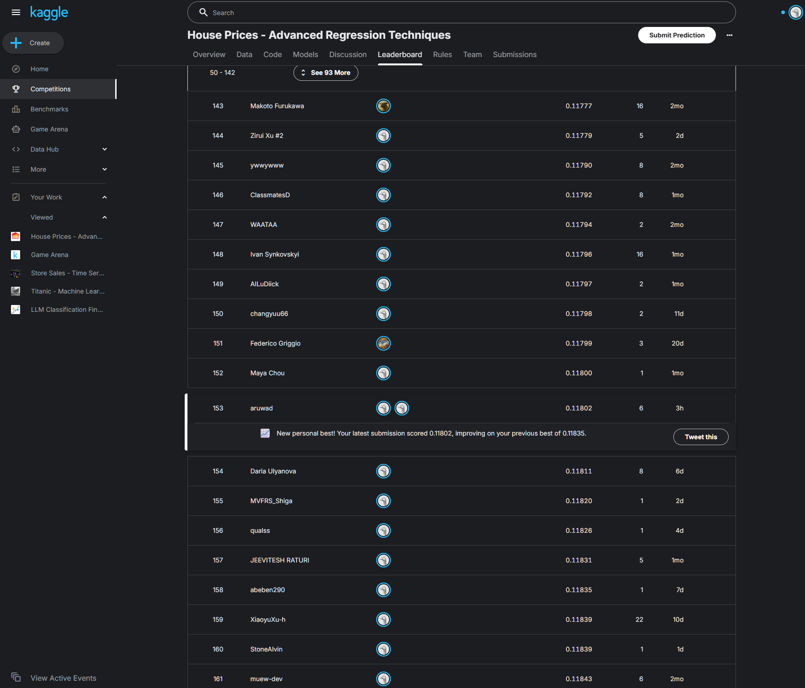

# Competition
- [House Prices - Advanced Regression Techniques](https://www.kaggle.com/competitions/house-prices-advanced-regression-techniques)
- One of the most popular introductory ML competition for typical tabular regression.
- Has its official leaderboard, where a solid foundation of tabular ML is required for top ranks.
- Data: 1,460 train samples, with 79 features
- Participants: 1,013,400 entrants / 4,042 participants / 13,808 submissions (as of 2026-10-09)

# Results (as of 2026-10-09)
| Method | RMSE | Rank |
|---|---|---|
| Baseline | 0.2145 | 3551/3931 (90.33%) |
| XGB / HPO / Voting | 0.1198 | 273/3931 (6.94%) |
| Log-Ridge | 0.1184 | 157/3931 (3.99%) |
| **Data Pruning** | **0.1180** | **153/3931 (3.89%)** |

 

# Highlights
- A well-established example of modern ML pipeline for typical tabular regression.
- Feature selection based on EDA: log transformation and data pruning.
- Competitive and practical level of performance: 0.1180 of RMSE (153/3931, 3.89%)

# Technical Summary
- Input: $X \in \mathbb{R^{1460 \times 79}}$
  - 36 numerical + 43 categorical
- Output: $y \in \mathbb{R^{1460 \times 1}}$
  - 1 float
- Preprocessing
  - Numerical
    - `SimpleImputer('mean')`
    - `StandardScaler()`
    - `np.log1p(x)`: for 19 area-related features
  - Categorical
    - `SimpleImputer('most_frequent')`
    - `TargetEncoder()`
- Data pruning: based on the usefulness
- Model
  - Ensemble: `VotingRegressor()`
  - Base estimators: `XGBRegressor` / `RidgeRegressor` / `CatBoostRegressor`
- Seed averaging
- Optimal `n_threads` analysis for `CatBoostRegressor`