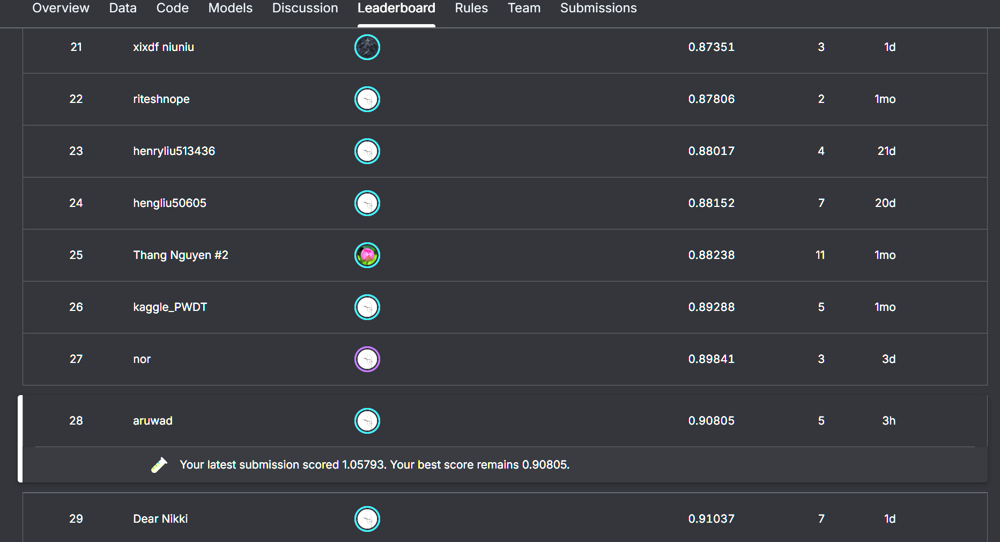

# Human Preference Prediction with Gemma 2

Task-aware input construction, validation, and offline deployment for human-preference classification.

## Competition

[LLM Classification Finetuning](https://www.kaggle.com/competitions/llm-classification-finetuning) · Project: **2026-10-10–2026-10-13**

- **Task:** predict whether a human preferred response A, response B, or a tie, given a prompt and two responses.
- **Data:** 57,477 labeled training rows; approximately 25,000 [hidden test rows](https://www.kaggle.com/competitions/llm-classification-finetuning/data). Inputs: `prompt`, `response_a`, `response_b`. IDs are for alignment only.
- **Metric:** multiclass log loss; submit three probabilities summing to one.

## Results — snapshot: 2026-10-13

**Best public score: 0.90805 · rank 28/250 (top 11.2%).** Rolling public leaderboard—not a final placement or medal-awarding competition.

| Submission | Public log loss ↓ | Outcome |
|---|---:|---|
| Gemma 2 2B + LoRA, single pass | 0.97220 | Initial scored LoRA baseline |
| **Gemma 2 9B + LoRA, 2,048 tokens, single pass, T=0.9** | **0.90805** | **Best successful submission** |
| Gemma 2 9B + A/B-swap TTA, T=0.9 | — | Timed out |
| Gemma 2 9B, merged adapters + runtime-selected shorter context | 1.05793 | Rejected regression |

The best submission reduced public log loss by **0.06415 (6.60%)** versus the 2B baseline.

## Highlights

**Central design idea: treat the input as a structured comparison, not one string to truncate.**

- **Response-preserving token budgets:** decode multi-turn JSON; keep complete inputs when they fit; otherwise reserve space for both answers, redistribute unused capacity, and retain section beginnings/endings. This avoids simply truncating trailing response B.
- **Task-aware evaluation:** split by normalized prompt, align models by example ID, and reverse A/B labels when swapping 50.2% of training rows. Swaps remain fixed across epochs.
- **Deployment engineering:** compare TTA, calibration, and ensembles using saved logits; verify tokenizer/head restoration; repair cross-GPU adapter/head placement for offline T4×2 inference.

Contribution: task-specific engineering, not a new fine-tuning algorithm. Bundled changes were not isolated by ablation.

## Technical Summary

**Validation:** one held-out fold from prompt-grouped `StratifiedGroupKFold`, not five-fold training: **45,981 train / 11,496 validation**. The 9B run splits validation into **5,747 selection / 5,749 audit**; selection controls checkpoint/calibration/blend choices. Audit was already included in the earlier 2B evaluation.

**Training:** `AutoModelForSequenceClassification` + cross-entropy; LoRA on transformer linear layers and a trainable classification head. Rank/alpha **32/64**, BF16 backbone, FP32 trainable parameters, effective batch **32**, peak LR **5e-5**, 5% warmup + linear decay. Early stopping: **1.50 epochs**; best: **checkpoint-1440**. One RTX 5090: **12.3 hours** including periodic evaluation, **22.84 GiB** peak PyTorch allocation. No QLoRA or full-parameter fine-tuning.

**Successful submission:** FP16 backbone computation across T4×2, saved FP32 head/adapters, dynamic padding, length sorting, and `softmax(logits / 0.9)`. No TTA, ensemble, merging, quantization, generation, or full validation pass. Multi-GPU **inference**, not distributed training.

## Findings and Limits

| Local configuration | Selection loss ↓ | Audit loss ↓ |
|---|---:|---:|
| 2B, original order, T=1 | 0.962445 | 0.967096 |
| 9B, original order, T=1 | 0.895299 | 0.914849 |
| 9B + swap-TTA, T=1 | 0.883663 | 0.898659 |
| 9B + swap-TTA, T=0.9 | 0.881159 | 0.898040 |

The local recipe selected **zero 2B weight**. TTA helped locally but timed out during submission. **T=0.9 was selected with TTA**, then retained—not independently optimized—for single-pass inference.

The runtime-first fallback regressed. Its development run selected **256 total tokens**; the hidden-run cap is unconfirmed. Truncation, precision, and merging were not isolated. **Runtime success alone does not establish prediction quality.**

Evidence: completed notebook outputs, training/evaluation reports, [leaderboard](./final_leaderboard.png), and [submission results](./submission_results.png).

Methods informed by the historical LMSYS [first-place](https://www.kaggle.com/competitions/lmsys-chatbot-arena/discussion/527629) and [second-place](https://www.kaggle.com/competitions/lmsys-chatbot-arena/discussion/527685) reports, [PEFT](https://huggingface.co/docs/peft/package_reference/lora), and [temperature scaling](https://proceedings.mlr.press/v70/guo17a.html).
